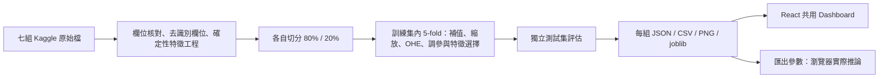

# Kaggle Multiple Linear Regression Lab

人工智慧課程專案：在**同一個 React 單頁 Dashboard** 切換七組 Kaggle 資料，呈現五模型比較、前向特徵選擇、診斷與實際模型預測。所有圖表分數由 Python 訓練產生；網站不需要 Python 伺服器。

## 啟動網站

在終端機進入這個 `HW2` 資料夾，執行：

```powershell
npm.cmd ci
npm.cmd run dev
```

開啟終端機顯示的網址，通常是 `http://127.0.0.1:5173`。Windows 若擋住 `npm.ps1`，使用上面的 `npm.cmd`，不用修改 PowerShell 執行原則。其他系統可直接使用 `npm`。

`public/data/` 已提供七組真實訓練成果，因此單純使用網站不必先安裝 Python、取得 Kaggle 帳號或重新訓練。

## 架構與檔案

```text
HW2/
├── ml/
│   ├── registry.py          七組來源、目標、單位與清理說明
│   ├── data.py              指定版本下載、SHA256 核對、讀檔、清理與 audit
│   ├── provenance.py        Kaggle 官方版本與授權快照
│   ├── selection.py         fold 內快取與平行前向選擇
│   ├── test_selection.py    快取與逐步 Pipeline 的數值對照
│   ├── verify_exports.py    全部 35 個模型的 JS／Python 對照
│   ├── descriptions.py      繁體中文欄位字典
│   ├── finalize.py          同步既有成果的說明與來源 metadata
│   └── train.py             五模型、CV、Forward Selection、診斷、模型匯出
├── src/
│   ├── main.tsx             共用六區塊、Dropdown、表單、下載與錯誤處理
│   ├── inference.mjs        與 sklearn 一致的瀏覽器前處理／模型推論
│   ├── styles.css           響應式學術 Dashboard、Tailwind 入口
│   └── vite-env.d.ts
├── public/data/
│   ├── registry.json
│   ├── audit.json           七組實際原始欄位核對
│   └── <dataset-id>/
│       ├── source.json     Kaggle 版本、授權、ZIP 指紋
│       ├── results.json    概覽、五模型、全部前向選擇步驟、診斷與表單
│       ├── model.json      CV 推薦模型的實際已訓練參數
│       ├── parity.json     Python 預測對照案例（含補值、未知類別）
│       ├── model_comparison.csv
│       ├── feature_selection.csv
│       ├── test_predictions.csv
│       ├── summary.json
│       ├── report.md
│       ├── test_rmse.png / test_r2.png
│       ├── features_test_rmse.png / features_test_r2.png
│       └── diagnostics.png
├── tests/                  真實成果／推論一致性測試、React DOM 互動測試
├── docs/PROJECT.md          課堂報告介紹與方法限制
├── docs/RESULTS.md          從實際訓練輸出整理的結果摘要
├── requirements.txt
├── package.json / package-lock.json
├── vite.config.ts / tsconfig.json / index.html
├── data/raw/               本地原始 ZIP；Git 忽略
├── artifacts/<id>/         五個已訓練 joblib 模型；Git 忽略
└── dist/                   npm run build 產物；Git 忽略
```



## 實際資料核對與限制

以下數字由讀取真實檔案得到；有效原始特徵數已排除目標、識別碼與明確洩漏／排除欄位。**衍生特徵數、OHE 後數量不可冒充原始欄位數。**

| ID | Kaggle 版本 | 來源筆數 | 有效原始特徵 | 候選特徵 | 目標與單位 |
|---|---:|---:|---:|---:|---|
| king-county | 1 | 21,613 | 18 | 18 | price / USD |
| spotify | 1 | 114,000 | 15 | 15 | popularity / 0–100 分 |
| laptop | 1 | 1,303 | 11 | 11 | Price_euros → Price / EUR |
| bike | 1 | 17,379 | 12 | 12 | cnt → count / 每小時次數 |
| used-car | 4 | 8,128 | 12 | 12 | selling_price → Selling_Price / INR |
| house-rent | 9 | 4,746 | **10** | 14 | Rent / INR 每月 |
| flight | 1 | 10,683 | **8**（來源原有 10 個輸入） | 12 | Price / INR |

來源網址、更新時間、原始欄名、缺失值、清理後樣本數、OHE 特徵與實際使用筆數，請查看網站「欄位字典與來源驗證」及每組 `source.json`／`results.json`。原始檔為完整來源；清理後會因去重與移除缺失目標而減少筆數。

- **King County**：同房屋 ID 只保留第一筆，再排除 ID／交易日期，避免同一房屋跨訓練與測試集。
- **Spotify**：依 track_id 去重，避免同一歌曲在多曲風重複列中跨集合。移除曲名、專輯、藝人與索引，保留音訊與曲風。
- **Laptop**：移除 laptop_ID。產品名稱取系列首字、CPU／GPU 取前兩個詞；RAM／重量轉數值。表單直接填清理後欄位。
- **Bike**：使用較完整的 Kaggle/UCI Capital Bikeshare hourly 版本，而非需要競賽認證的原始 competition ZIP。`casual + registered = cnt`，因此這兩欄絕不進模型。資料依時間切分 80/20，訓練使用 `TimeSeriesSplit(5)`。評估是已知同期天氣條件的需求估計，不代表未知天氣的即時預報。
- **Used Car**：較小 `car data.csv` 不符特徵下限，採同一 Kaggle 資料包的 `Car details v3.csv`。車名轉品牌，里程／引擎／功率／扭力取數值，kgm 扭力轉 Nm；mileage 的 km/l 與 km/kg 依燃料別解讀。
- **House Rent**：排除 `Point of Contact`，有效原始欄位不足 11。日期拆年／月／日／星期；Floor 拆所在樓層／總樓層。這是合理的工程方案，**不能宣稱原始特徵已達 11；須先取得授課教師對方案的認可**。地區可能稀疏，租金極端值未任意刪除。
- **Flight**：來源實際是 Excel。10 個原始輸入中排除重複 Route 與可能包含價位資訊的 Additional_Info，剩 8 個。日期與時間拆成可解釋特徵，飛行時間統一分鐘；工程後 12 個候選特徵。**原始數量要求仍未達標，需教師認可方案**。

各份資料有自己的單位，不可直接把不同資料集的 RMSE 當作同一尺度比較。資料授權由各來源決定，網站保留來源與授權標示；本地原始檔與 joblib 未加入 Git。

## 重新訓練

已驗證環境：Node 24、Python 3.14。建議建立乾淨虛擬環境，依 `requirements.txt` 安裝固定版本：

```powershell
python -m venv .venv
.\.venv\Scripts\python.exe -m pip install -r requirements.txt
.\.venv\Scripts\python.exe ml/data.py
.\.venv\Scripts\python.exe ml/train.py --max-rows 0
.\.venv\Scripts\python.exe ml/finalize.py
.\.venv\Scripts\python.exe ml/verify_exports.py
npm.cmd test
npm.cmd run build
```

如果終端機找不到 `python`，請安裝 Python，或使用 `py -3.14`／已安裝 Python 的完整路徑建立環境。資料下載使用 Kaggle 官方公開 API，不需將帳號或 API 金鑰寫入專案。若 Kaggle 要求認證，請從每組 Kaggle 頁面手動下載對應版本，將完整 ZIP 放到 `data/raw/<id>.zip`，勿解壓更名。機票包內須包含 `Data_Train.xlsx`。

快跑（真實抽樣，畫面會明確標示）：

```powershell
.\.venv\Scripts\python.exe ml/train.py --max-rows 2500
```

僅重跑一組：

```powershell
.\.venv\Scripts\python.exe ml/train.py --dataset spotify --max-rows 0
```

預設 `--max-rows 0` 使用全量**清理後**資料；完整 Forward Selection 會測試所有剩餘候選欄位，每個候選重新做 5-fold，Spotify 等大資料需要較長時間。沒有以測試集選擇模型或組合。

中斷後可加上 `--resume`，跳過已有相同來源 ZIP 指紋的完整全量成果。森林使用 8 個 worker，前向選擇使用 4 個執行緒；資源較少的電腦可調低 `train.py` 的 `n_jobs` 與 `selection.py` 的 `n_jobs`。每個 fold 的獨立欄位前處理可快取，統計值只來自該 fold 的訓練部分，沒有跨 fold 或使用測試資料。`python ml/test_selection.py` 會把快取 CV 分數與逐候選重建 Pipeline 對照（容許浮點數值誤差）。

下載固定為 `source.json` 的 Kaggle 版本，並校驗 ZIP SHA256。若不一致會停止，請核對下載版本與內容，勿直接修改指紋掩蓋差異。`ml/provenance.py` 用來建立來源 metadata；有既存匹配快照時會保留。要更新資料版本，先另外保留舊資料與來源快照，再有意識地替換原始檔與來源設定、重跑全部分析；不要在不同版本間沿用分數。

## 方法與瀏覽器推論

五個模型為 Linear Regression、Ridge、Lasso、ElasticNet、Random Forest。補值、數值標準化、One-Hot Encoding 均位於每個 CV fold 的 Pipeline／ColumnTransformer；目標縮放使用 `TransformedTargetRegressor(StandardScaler)`，也只 fit 當前訓練 fold，避免不同幣值造成正則化難以收斂。模型最佳參數與分數完整輸出。

前向選擇以**候選原始／工程欄位為群組**加入，類別欄位對應的 OHE 欄位一起加入；從 1 個至全部候選欄位，保留每步 CV RMSE／Test RMSE／Test R²。最佳組合僅由 CV RMSE 決定。這個分析使用 Linear Regression，與五模型比較的推薦模型分開呈現。

`model.json` 保存訓練後的補值、均值、標準差、類別順序、係數或森林樹節點；匯出時已將目標縮放還原到實際單位。`src/inference.mjs` 嚴格使用同一欄位順序與未知類別全零編碼；森林比對輸入採 `Math.fround`，對齊 sklearn 的 float32 樹推論。預測使用 CV 推薦模型，所有五種模型可匯出；沒有估價公式、亂數或後端 API。

表單為模型實際接收的**清理／工程後欄位**，不是原始字串自動解析器。例如機票需輸入拆解後小時／分鐘，租屋需輸入數值樓層，筆電需選清理後 CPU 系列。預設值、選項與最小／最大值只根據訓練集。輸入範圍限制只代表來源資料觀察範圍，不保證所有欄位組合都符合現實；模型可能對未見組合失準。

診斷的過擬合／欠擬合提示根據實際學習曲線與門檻產生，屬啟發式證據；殘差相關只衡量線性相關，不能取代看圖。線性模型可能產生負數或超過流行度上限，網站會顯示說明並保留原始預測，不偷偷截斷。

## 網站操作

右上方「中文 / EN」按鈕可切換繁體中文與英文，涵蓋介面、資料介紹、欄位說明、單位與診斷解讀。切換時保留目前資料集、輸入與預測結果；語言偏好會儲存在瀏覽器，重新整理後仍會保留。

1. 在上方選擇資料集；六個區塊、目前來源、單位與下載會一起換。
2. 概覽展開欄位字典；區分來源筆數、清理筆數、分析筆數、原始／候選／編碼後特徵。
3. 模型比較可依 CV RMSE、Test RMSE、Test R² 排序；深綠色是訓練 CV 推薦。
4. 比較前向選擇曲線與最佳組合；勿因看到測試曲線而回頭選模型。
5. 查看模型診斷，再在預測表單填入範圍內欄位，按「產生預測」。切換資料集會卸載表單並清除上一組紀錄。
6. 表單可重設輸入、下載本次資料集的即時預測 CSV；最下方可下載測試集預測、模型比較、前向選擇、PNG、摘要及報告。檔名包含 Dataset ID。

## 測試與錯誤排除

```powershell
npm.cmd test
npm.cmd run build
npm.cmd run preview
```

- Node 測試讀取**真實訓練輸出**，核對 7 個 ID、35 組模型評估、每步前向選擇、推薦規則、樣本／特徵維度與所有下載檔。每組 21 個 Python 對照案例驗證 JS 推論（20 個測試樣本與 1 個缺值／未知類別案例），相對容許誤差 `1e-7`。
- `ml/verify_exports.py` 額外載入本地全部 35 個 joblib，各以 21 個案例對照 JavaScript（共 735 次），結果寫入 `public/data/verification.json`；這項檢查需要本地訓練產物，部署的 CI 不需安裝 Python 執行它。
- React DOM 測試逐一切換七組，驗證輸入欄位型態／預設值、模型輸出、單位、下載檔名、必填檢查、重設；另測快速切換競態、404 隔離與切換後復原。
- DOM 測試不能取代實際桌面／手機瀏覽器的視覺檢查。本次執行環境未提供可連接瀏覽器，因此未聲稱完成螢幕截圖驗收。
- **沒有分析結果／404**：先確認 `public/data/<id>/results.json`，執行該 ID 的訓練，再重新建置。單組失敗不會阻止選取其他資料。
- **直接雙擊 index.html 空白**：Vite 專案需使用 dev／preview HTTP 伺服器；部署請上傳 `dist/`。
- **模型 ID 不一致**：清除舊快取、重新部署同一批 `results.json` 與 `model.json`。網站遇到此情況會停止推論。
- **載入失敗**：頁面有重新載入按鈕。非同步請求會在切換時 Abort，避免舊結果覆蓋新選擇。
- **來源變更或收斂警告**：先檢查資料版本、欄位、數值解析；不可隱藏錯誤或填入固定成績。

## GitHub Pages 部署

本專案已整合至 Git repo 原有 `../.github/workflows/startup-pages.yml`，保留原網站與 test3，新增 HW2 的安裝／測試／建置步驟，組裝至 `_site/HW2/`。使用提交的預訓練 JSON／模型與圖表，CI 不需下載 Kaggle 或重新訓練。

1. 將 `HW2/` 原始碼、`public/data/` 成果與修改後 workflow 一起提交並推送至 `main`。
2. GitHub repository → **Settings → Pages → Build and deployment → Source：GitHub Actions**。
3. 執行 **Build course labs and publish Pages**（或 push main 自動觸發）。
4. 成功後本 repo 的預期入口為 `https://xin-bit-cpu.github.io/test2/HW2/`；實際網址以 Actions 的 deployment URL 為準。

`vite.config.ts` 使用 `base: './'`，可放在 repo 的 `HW2/` 子路徑，所有資料與模型 URL 也使用相同 BASE_URL。推送 `main` 後會自動執行測試與部署；請以 GitHub Actions 成功結果與實際頁面回應確認上線狀態。

官方參考：[scikit-learn ColumnTransformer](https://scikit-learn.org/stable/modules/generated/sklearn.compose.ColumnTransformer.html)、[Vite 靜態部署／GitHub Pages](https://vite.dev/guide/static-deploy.html)。七個 Kaggle 原始來源保留於 `ml/registry.py` 與網站來源連結。
